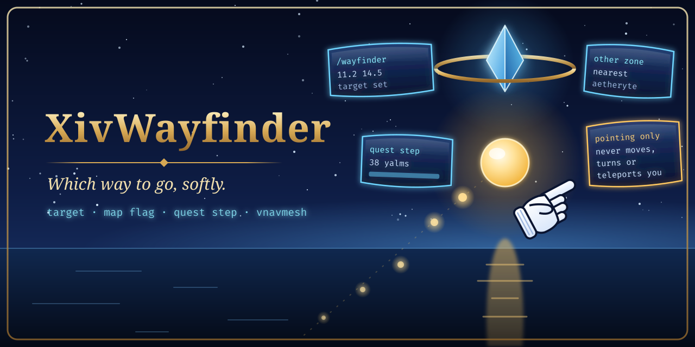

# XivWayfinder

The default guide is the game’s 3D Wind-up Cursor, floating above and just ahead of you even without the route line or an active destination. When it sees the destination, that same cursor rushes over and hovers above it, pointing down with a slow bounce. A gentle hum builds as you approach and resolves into a resonant bell on arrival. Sound has mute, volume and preview controls in Guide settings; `/wayfinder soundtest` previews the sound. Reduced motion removes travel and bouncing.

<p align="center">
  <picture>
    <source media="(prefers-color-scheme: dark)" srcset="images/readme/hero-dark.png">
    <source media="(prefers-color-scheme: light)" srcset="images/readme/hero-light.png">
    
  </picture>
</p>


**[Site](https://spacegho.st/mods/ffxiv/xivwayfinder/) · [Install](https://spacegho.st/mods/ffxiv/plugins/) · [Vote on what's next](https://spacegho.st/mods/ffxiv/xivwayfinder/vote/) · [Screenshots](https://spacegho.st/mods/ffxiv/term/gallery/?mod=xivwayfinder) · [Changelog](CHANGELOG.md)**

**A companion and a glowing trail to help you find your way in FINAL FANTASY XIV.**

XivWayfinder is a Dalamud plugin with searchable game models and imported local models for your guide.
Preview a pointer, moogle, chocobo, character or another model while the selector stays open, then choose
its size, animation and placement. A pulsing line or fairy lights follow the confirmed walking route,
on the ground or floating overhead. The classic bead and flat glove remain optional styles.

Follow a target you set (`/wayfinder 11.2 14.5`), your map flag or a tracked quest.
[vnavmesh](https://github.com/awgil/ffxiv_navmesh) supplies walkable paths; guidance waits when a route cannot
be confirmed. Cross-zone travel is described in the [journey guide](docs/JOURNEYS.md).

> **No automatic walking.** XivWayfinder never walks or turns your character. Optional automatic Teleport is
> off by default: opt in with `/wayfinder autoteleport on` or in settings. It uses the game's spell and normal
> gil costs, up to the configured limit, when safely idle. Interrupted/refused casts need an explicit retry.

> **Development status:** native pointer, moogle, chocobo and selected character models have rendered in game.
> Imported Fox and CesiumMan models have also rendered and animated, with saved selection and preview restoration
> checked. Ground and overhead trails have been observed on flat ground and a gentle bevel. The complete model
> catalog, sharp stairs and changing terrain still need live checks. See the [dated evidence and limitations](docs/WAYFINDER.md).

[Install](#install-dev-plugin) · [Commands](#commands) · [Settings](#settings) · [For other plugins](#for-other-plugins) ·
[Full guide](docs/WAYFINDER.md) · [IPC](docs/IPC.md)

## What you get

- **The bead**: floats 1.5 to 3 yalms ahead of you at chest height, bobbing, with a breathing glow. It dims as
  you face the right way and brightens as you turn away, so a glance says whether you are on course.
- **The glove**: the white pointing-hand cursor from the game's own files (`ui/uld/Cursor.tex`), read at run
  time, never copied into this repository. Near your character while the way is on screen, clamped to the screen
  edge and pointing when it is not, with a little tap. Without that texture, XivWayfinder draws an original glove of
  its own. Choose **bead**, **glove** or **both**.
- **A model companion**: search minions, characters, creatures and other supported game models, including the
  *Wind-up Cursor*. Click to preview without closing the selector. Choose grounded movement or floating placement;
  verified native clips provide walking and running where available. These are local visual actors, visible only
  to you. The full catalog has not been checked individually.
- **Your own models**: import GLB/glTF, OBJ and ZIP model packs, preview animation clips, and save models to your
  collection. Search external repositories from the library and open a model's source page. See
  [supported formats and limits](docs/WAYFINDER.md#imported-models) before downloading a model.
- **Path highlighting**: fairy lights or classic beads and a pulsing line follow vnavmesh's confirmed walkable
  route. Choose ground placement or a floating trail overhead. Ground marks, including their glow and the arrival
  ring, split across measured collision faces; native scene depth lets the world occlude them. Missing route or
  floor coverage waits for confirmation. See [trail rendering and checks](docs/WAYFINDER.md#trail-terrain-and-checks).
- For a target in another zone: *Teleport to (aetheryte)* instead of an arrow, attuned aetherytes first.
- Steps aside in cutscenes, zone changes, group pose and with the UI hidden; in combat and duties too unless you
  say otherwise.

## Requirements

- FFXIV with Dalamud (API 15). Linux under Wine and Windows alike; nothing here is platform-specific.
- Optional: vnavmesh, for walkable paths.

## Install (from the plugin repository)

```text
https://spacegho.st/mods/ffxiv/plugins.json
```

1. `/xlsettings` → **Experimental** → **Custom Plugin Repositories**: add the URL, **+**, save.
2. In the same tab, tick **Get plugin testing builds**: XivWayfinder has test builds only so far.
3. `/xlplugins` → **All Plugins**: search **XivWayfinder** and install it.

## Install (dev plugin)

```sh
git clone https://github.com/Spaceghost/xivwayfinder-dalamud.git
cd xivwayfinder-dalamud
tools/fetch-dalamud.sh && tools/install-dev.sh
```

`tools/install-dev.sh` builds Release and stages the plugin beside the checkout at
`../xiv-wayfinder-build/devplugin/`, then prints the Wine path. Add it under `/xlsettings` → **Experimental** →
**Dev Plugin Locations**, then enable **XivWayfinder** under `/xlplugins` → **Dev Tools**. The script does not edit
Dalamud's configuration. `XIVWAYFINDER_ARTIFACTS` and `XIVWAYFINDER_STAGE` override the output folders.

## Commands

| Command | What it does |
| --- | --- |
| `/wayfinder` | Opens the settings. |
| `/wayfinder X Y [zone]` | Points at map coordinates: `11.2 14.5`, `(11.2, 14.5)`, `X: 11.2 Y: 14.5`, `21.5 22.1 central shroud`. |
| `/wayfinder clear` | Forgets that target. |
| `/wayfinder test [yalms]` | A target 20 yalms straight ahead: the quickest way to see it work. |
| `/wayfinder save NAME` · `go NAME` · `forget NAME` · `places` | Keep named non-housing places and point back to them. |
| `/wayfinder auto` · `target` · `flag` · `quest` | Follow everything by priority, or one source only. |
| `/wayfinder bead` · `glove` · `both` · `minion` | Choose a classic pointer style or the model guide. |
| `/wayfinder models [search]` · `localmodels` | Open the searchable game library or your local model collection. |
| `/wayfinder preview PATH` · `preview stop` | Preview a local model file, or restore your chosen guide. |
| `/wayfinder trail ground` · `trail overhead` | Place the trail on measured ground or above you. |
| `/wayfinder on` · `off` · `status` | Show, hide, or say what it is doing. |
| `/wayfinder autoteleport on` · `off` · `retry` | Opt into normal-cost Teleport for attuned guidance; disable it or explicitly retry an interrupted/refused cast. |

`/xivwayfinder` is the same command under the plugin's full name.

## Settings

Choose what to follow and its priority, your guide model, size, facing and animation, grounded or floating
placement, and how far the guide travels ahead. Preview models in the native library or local collection before
saving them. Configure fairy lights or the classic pulsing line, ground or overhead height, color, distance
readouts, arrival radius, and when guidance hides. The settings show the current destination and why a guide
is waiting or hidden. Details: [docs/WAYFINDER.md](docs/WAYFINDER.md).

## For other plugins

Four IPC functions and two events, no assembly reference needed. Full rules and the JSON: [docs/IPC.md](docs/IPC.md).

| Name | Signature | Meaning |
| --- | --- | --- |
| `XivWayfinder.v1.SetTarget` | `uint territoryId, float x, float z, string label → bool` | Point at world X/Z; territory 0 is the current one. |
| `XivWayfinder.v1.SetMapTarget` | `uint territoryId, float mapX, float mapY, string label → bool` | The same in map coordinates, as the game prints them. |
| `XivWayfinder.v1.Clear` | `→ bool` | Forget that target. |
| `XivWayfinder.v1.GetState` | `→ string` | JSON: source, target, zone, distance, aetheryte, why hidden. |

## Privacy and security

Ordinary route guidance does not contact external repositories. Choosing **Search repositories** contacts the
selected providers (Sketchfab, Poly Haven and/or ambientCG) for asset metadata; search terms are sent where the
provider's search API requires them. Clicking a result loads that selected preview image from the provider's
image host. No models are downloaded or installed automatically. **Open source page** opens the provider page
in your browser. Local imports read the model and its local resource files.
The plugin saves its settings and, for automatic Teleport, bounded character-scoped attempt journals.
It reads the game's own UI files for the glove picture, the game's sheets for zones, maps, aetherytes and the Wind-up Cursor minion, and the
journal, flag and map markers from game memory; it changes none of them. With the minion glove chosen it creates
one object of its own in the game's client-side object list (as Brio and Ktisis do for theirs), moves it, and
deletes it again; that object exists only in your game's memory.
If automatic Teleport is enabled, it also invokes the game's normal Teleport action, moving the character
and spending the quoted gil after the cast. Other plugins' targets can trigger this opted-in behavior;
`GetState.autoTeleport` reports the setting, cost limit and current status.

## Development

```sh
tools/fetch-dalamud.sh                               # Dalamud reference assemblies
dotnet test tests/XivWayfinder.Core.Tests -c Release
dotnet build src/XivWayfinder.Plugin/XivWayfinder.Plugin.csproj -c Release && tools/package.sh
```

`XivWayfinder.Core` holds everything that can be tested without the game (BCL only); the plugin project holds the
Dalamud glue. Every user-visible change edits `changelog.json`
(`tools/changelog.py` renders `CHANGELOG.md`); statuses mean: `new`/`fix` seen working in game, `beta` merged but
not verified in game, `next` still being built. Releasing: [docs/RELEASING.md](docs/RELEASING.md).
